# 🚀 Jenkins CI/CD Pipeline — Lab 1
🚀 Jenkins CI/CD Pipeline — Lab 1


## 📌 Présentation du projet

Ce projet consiste à mettre en place un pipeline CI/CD pour une application Java basée sur Spring Boot, en utilisant Jenkins, Maven, Docker, Kubernetes et GitHub.

L’objectif est de comprendre les différentes étapes de l’intégration continue et du déploiement continu, depuis la récupération du code source jusqu’au déploiement de l’application sur un cluster Kubernetes.

Le TP comprend deux approches complémentaires :

- **Workflow manuel :** compilation, création de l’image Docker, publication sur Docker Hub et déploiement Kubernetes.
- **Workflow automatisé :** utilisation de Jenkins pour automatiser le build, la création et la publication de l’image, puis le déploiement sur Kubernetes.

Le projet est réalisé dans un environnement Ubuntu Server avec un cluster Kubernetes composé d’un nœud Master et de deux Workers.

## 🎯 Objectifs pédagogiques

- Comprendre les principes de la CI/CD.
- Compiler une application Java avec Maven.
- Conteneuriser une application Spring Boot avec Docker.
- Publier une image sur Docker Hub.
- Déployer et vérifier une application sur Kubernetes.
- Installer et configurer Jenkins.
- Créer et exécuter des jobs Jenkins de type Freestyle.
- Récupérer des scripts depuis GitHub.
- Configurer un déclenchement périodique des builds.
- Automatiser un pipeline de déploiement de bout en bout.

## 🧰 Technologies utilisées

| Technologie | Version documentée | Rôle |
|---|---|---|
| Ubuntu Server | 26.04 | Système d’exploitation |
| Java JDK | 17 | Compilation et exécution Java |
| Spring Boot | 2.1.5 | Framework applicatif |
| Maven | 3.9.12 | Compilation et packaging |
| Docker | 29.1.3 | Conteneurisation |
| Kubernetes | 1.31.14 | Orchestration des conteneurs |
| Jenkins | 2.580.1 | Automatisation CI/CD |
| containerd | 2.2.2 | Runtime de conteneurs |
| Git et GitHub | — | Gestion du code source |
| Docker Hub | — | Registre d’images |

> Remarque : les versions ci-dessus correspondent aux versions documentées dans le TP. Vérifier les versions réellement installées sur les machines avant de reproduire les commandes.

## 📑 Sommaire

1. [Architecture du cluster](#1-architecture-du-cluster)
2. [Prérequis](#2-prérequis)
3. [Workflow manuel sans Jenkins](#3-workflow-manuel-sans-jenkins)
4. [Création du Dockerfile](#4-création-du-dockerfile)
5. [Build Maven et Docker](#5-build-maven-et-docker)
6. [Publication sur Docker Hub](#6-publication-sur-docker-hub)
7. [Déploiement Kubernetes](#7-déploiement-kubernetes)
8. [Installation de Jenkins](#8-installation-de-jenkins)
9. [Création du job Freestyle](#9-création-du-job-freestyle)
10. [Compilation et exécution de Test.java](#10-compilation-et-exécution-de-testjava)
11. [Intégration avec GitHub](#11-intégration-avec-github)
12. [Déclenchement automatique](#12-déclenchement-automatique)
13. [Configuration de Jenkins pour Docker et Kubernetes](#13-configuration-de-jenkins-pour-docker-et-kubernetes)
14. [Pipeline automatisé complet](#14-pipeline-automatisé-complet)
15. [Vérification finale](#15-vérification-finale)
16. [Structure du dépôt](#16-structure-du-dépôt)
17. [Auteur et liens utiles](#17-auteur-et-liens-utiles)

---

## 1. Architecture du cluster

Le cluster Kubernetes est composé de trois machines virtuelles Ubuntu Server.

```text
                     DÉVELOPPEUR
                          |
                          v
                        GitHub
                          |
                          v
                       Jenkins
                          |
                +---------+---------+
                |                   |
                v                   v
           Build Maven         Build Docker
                                    |
                                    v
                                Docker Hub
                                    |
                                    v
                            Cluster Kubernetes
                         +----------+----------+
                         |          |          |
                         v          v          v
                       Master    Worker 1    Worker 2
                                    |
                                    v
                         Application Spring Boot
                                    |
                                    v
                                 NodePort
```

### Répartition des nœuds

| Rôle | Hostname | Adresse IP documentée | Fonction |
|---|---|---|---|
| Master | `master` | `192.168.159.15` | Control plane Kubernetes et Jenkins |
| Worker 1 | `worker1` | `192.168.159.16` | Exécution des applications conteneurisées |
| Worker 2 | `worker2` | `192.168.159.17` | Exécution des applications conteneurisées |

> Vérifier les adresses IP réelles des machines virtuelles avant d’utiliser les commandes de déploiement.

## 2. Prérequis

Avant de commencer, les éléments suivants sont nécessaires :

- Une ou plusieurs machines virtuelles Ubuntu Server.
- Java JDK 17.
- Maven.
- Docker.
- Un cluster Kubernetes fonctionnel, basé sur K3s ou kubeadm.
- `kubectl` configuré pour accéder au cluster.
- Jenkins installé et opérationnel.
- Un compte GitHub.
- Un compte Docker Hub.
- Un accès réseau permettant de télécharger les dépendances et les images.

### Vérification des outils

```bash
java -version
mvn -version
docker --version
kubectl version --client
git --version
```

## 3. Workflow manuel sans Jenkins

Cette première partie permet de réaliser manuellement les principales étapes du déploiement.

### 3.1 Récupération du code source

Le projet Spring Boot utilisé pour le TP est disponible dans le dépôt suivant :

[Wahid007/Jenkins-Demo](https://github.com/wahid007/Jenkins-Demo)

```bash
git clone https://github.com/wahid007/Jenkins-Demo.git
cd Jenkins-Demo
```

**Capture 01 — Clonage du dépôt**

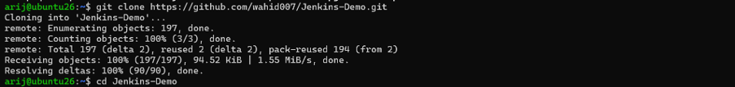

### 3.2 Étapes du workflow manuel

1. Récupération du code source.
2. Compilation de l’application avec Maven.
3. Création du Dockerfile.
4. Construction de l’image Docker.
5. Publication de l’image sur Docker Hub.
6. Déploiement de l’application sur Kubernetes.
7. Vérification de l’état des pods et du service.

## 4. Création du Dockerfile

Le Dockerfile permet de créer une image contenant l’application Spring Boot.

```dockerfile
FROM eclipse-temurin:17-jre

WORKDIR /app

COPY target/*.jar app.jar

EXPOSE 8080

ENTRYPOINT ["java", "-jar", "app.jar"]
```

### Explication

| Instruction | Description |
|---|---|
| `FROM` | Définit l’image Java de base |
| `WORKDIR` | Définit le répertoire de travail |
| `COPY` | Copie le fichier JAR généré par Maven |
| `EXPOSE` | Documente le port utilisé par l’application |
| `ENTRYPOINT` | Définit la commande de démarrage |

**Capture 02 — Création du Dockerfile**

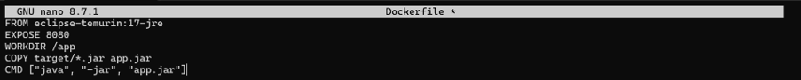

## 5. Build Maven et Docker

### 5.1 Compilation avec Maven

```bash
mvn clean install
```

Cette commande nettoie les fichiers générés précédemment, compile le projet, exécute les tests configurés et prépare les artefacts de l’application.

Résultat attendu :

```text
[INFO] BUILD SUCCESS
```

**Capture 03 — Build Maven réussi**

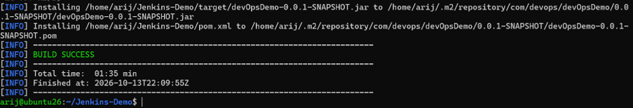

### 5.2 Construction de l’image Docker

```bash
docker build -t jenkins-demo:1.0.0 .
```

Vérification de l’image créée :

```bash
docker images
```

**Capture 04 — Construction de l’image Docker**

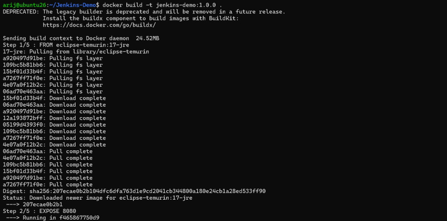

## 6. Publication sur Docker Hub

L’image doit être publiée dans un registre accessible aux nœuds Kubernetes.

### 6.1 Connexion à Docker Hub

```bash
docker login -u arijbelaid
```

Utiliser l’authentification demandée par Docker. Ne jamais enregistrer un mot de passe directement dans le dépôt GitHub.

**Capture 05 — Connexion à Docker Hub**

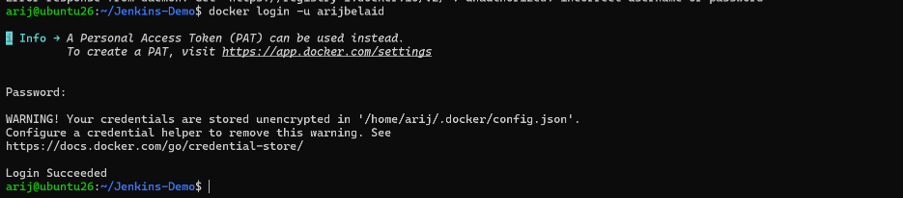

### 6.2 Tag de l’image

```bash
docker tag jenkins-demo:1.0.0 arijbelaid/jenkins-demo:1.0.0
```

**Capture 06 — Tag de l’image**

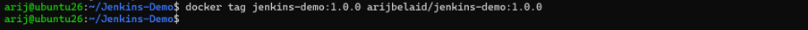

### 6.3 Publication de l’image

```bash
docker push arijbelaid/jenkins-demo:1.0.0
```

Vérifier ensuite que l’image est disponible sur [Docker Hub — arijbelaid](https://hub.docker.com/u/arijbelaid).

**Capture 07 — Publication de l’image**

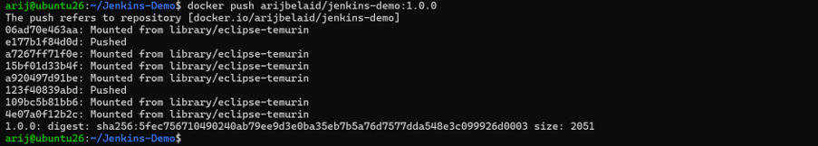

## 7. Déploiement Kubernetes

### 7.1 Test local du conteneur

```bash
docker run -d \
  --name container-jenkins \
  -p 8080:8080 \
  arijbelaid/jenkins-demo:1.0.0
```

Vérifier son état :

```bash
docker ps
docker logs container-jenkins
```

**Capture 08 — Exécution du conteneur Docker**

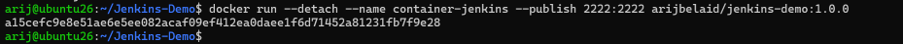

### 7.2 Test de l’application

```bash
curl http://localhost:8080
```

Si l’application utilise un endpoint différent de `/`, adapter l’URL au contrôleur ou à la page réellement disponible.

**Capture 09 — Test de l’application avec cURL**

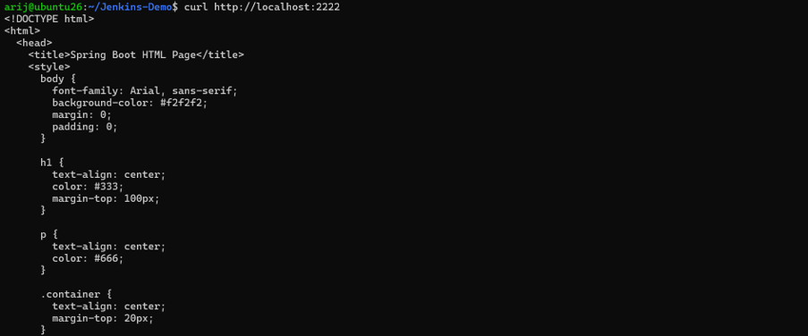

### 7.3 Application des manifests Kubernetes

Les fichiers `deployment.yaml` et `service.yaml` décrivent respectivement le déploiement et l’exposition de l’application.

```bash
kubectl apply -f deployment.yaml
kubectl apply -f service.yaml
```

Vérifier les ressources :

```bash
kubectl get deployments
kubectl get pods -o wide
kubectl get services
```

**Capture 10 — Déploiement Kubernetes**

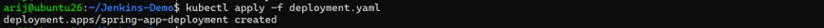

## 8. Installation de Jenkins

Jenkins automatise les tâches de compilation, de construction et de déploiement.

### 8.1 Installation de Java

```bash
sudo apt update
sudo apt install -y fontconfig openjdk-17-jdk
```

Vérifier la version :

```bash
java -version
```

### 8.2 Configuration du dépôt Jenkins

Consulter la [documentation officielle d’installation de Jenkins](https://www.jenkins.io/doc/book/installing/) pour utiliser le dépôt et la clé correspondant à la version actuelle.

Pour une distribution compatible avec le dépôt Debian stable, les commandes de configuration sont :

```bash
sudo mkdir -p /etc/apt/keyrings

sudo wget -O /etc/apt/keyrings/jenkins-keyring.asc \
  https://pkg.jenkins.io/debian-stable/jenkins.io-2026.key

echo "deb [signed-by=/etc/apt/keyrings/jenkins-keyring.asc] https://pkg.jenkins.io/debian-stable binary/" \
  | sudo tee /etc/apt/sources.list.d/jenkins.list > /dev/null
```

> Vérifier la disponibilité de la clé et la compatibilité du dépôt avec la version d’Ubuntu installée avant de poursuivre.

### 8.3 Installation et démarrage

```bash
sudo apt update
sudo apt install -y jenkins

sudo systemctl enable --now jenkins
sudo systemctl status jenkins
```

Le service doit être actif.

### 8.4 Accès à l’interface Jenkins

Si le pare-feu UFW est activé et que le port doit être autorisé :

```bash
sudo ufw allow 8080/tcp
```

Récupérer le mot de passe initial :

```bash
sudo cat /var/lib/jenkins/secrets/initialAdminPassword
```

Depuis le navigateur, ouvrir :

```text
http://192.168.159.15:8080
```

Remplacer l’adresse IP si nécessaire.

## 9. Création du job Freestyle

Le premier job Jenkins, nommé `freestyle_demo`, permet de vérifier l’exécution d’un script shell.

### 9.1 Création du job

Dans l’interface Jenkins :

1. Cliquer sur **Nouvel Item**.
2. Saisir `freestyle_demo`.
3. Choisir **Freestyle project**.
4. Cliquer sur **OK**.
5. Ajouter une étape **Exécuter un script shell**.

### 9.2 Script shell

```bash
echo 'Bonjour'
ls -l
echo 'Bonjour DevOps' > test.txt
ls -l
```

Enregistrer la configuration, puis lancer un build.

### 9.3 Vérification

Résultat attendu dans la console :

```text
Bonjour
Bonjour DevOps
Finished: SUCCESS
```

**Capture 11 — Configuration du job**

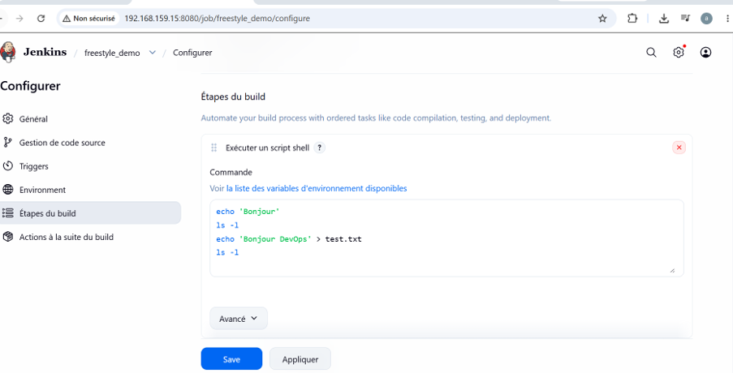

**Capture 12 — Tableau de bord Jenkins**

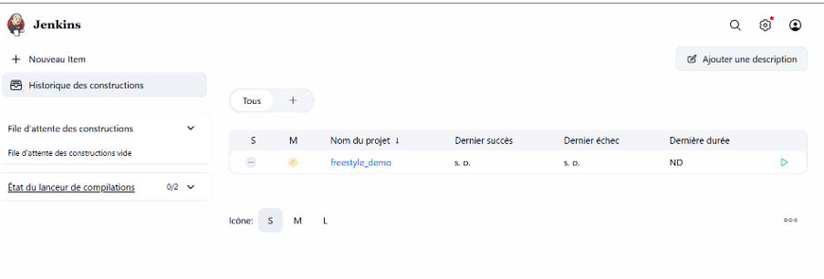

**Capture 13 — Console du build**

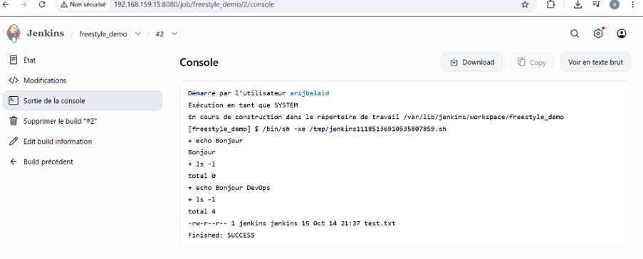

**Capture 14 — Vérification sur la VM**

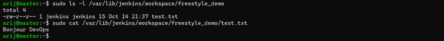

Vérification sur le système :

```bash
sudo ls -l /var/lib/jenkins/workspace/freestyle_demo
sudo cat /var/lib/jenkins/workspace/freestyle_demo/test.txt
```

Contenu attendu :

```text
Bonjour DevOps
```

## 10. Compilation et exécution de Test.java

Cette étape permet d’exécuter un programme Java depuis le job Jenkins.

### 10.1 Création du fichier Java

Dans le workspace du job, créer `Test.java` :

```java
public class Test {
    public static void main(String[] args) {
        System.out.println("Hi Master DevOps");
    }
}
```

Pour un test pédagogique, le fichier peut être créé directement dans le workspace. Dans un pipeline durable, il est préférable de versionner les sources dans GitHub.

**Capture 15 — Création de Test.java**

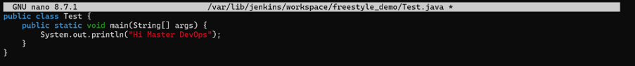

### 10.2 Compilation et exécution

Ajouter les commandes suivantes au script shell :

```bash
echo '--- Compilation et exécution de Test.java ---'
javac Test.java
java Test
```

Résultat attendu :

```text
Hi Master DevOps
Finished: SUCCESS
```

**Capture 16 — Attribution des droits**

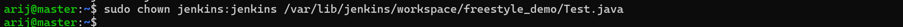

**Capture 17 — Configuration du job Java**

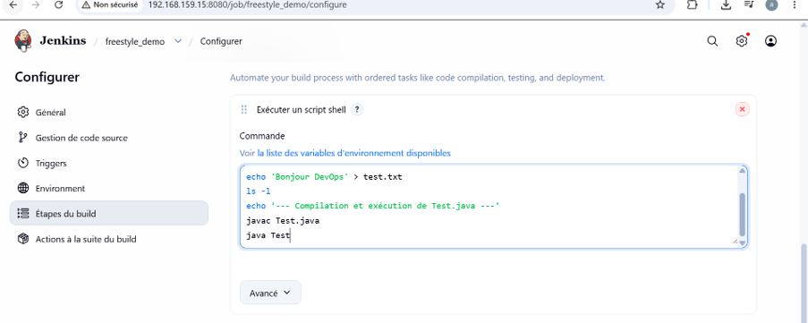

**Capture 18 — Console du build Java**

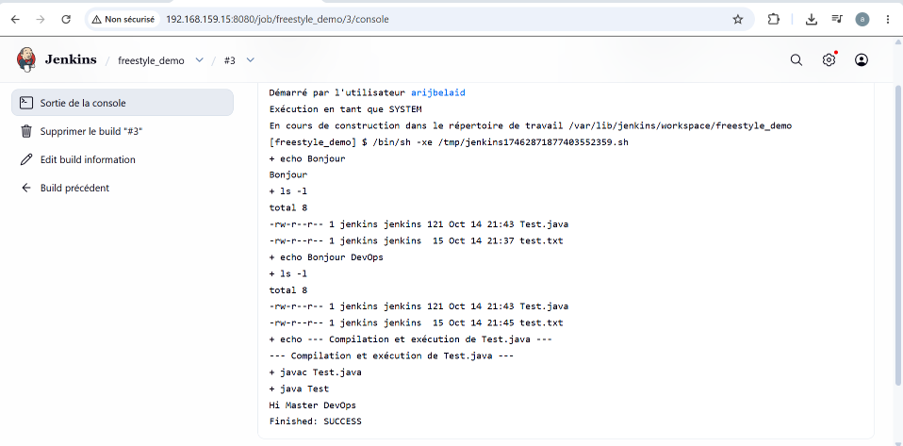

## 11. Intégration avec GitHub

Le script de build est hébergé dans ce dépôt :

[arijbelaid/jenkins-scripts](https://github.com/arijbelaid/jenkins-scripts)

### 11.1 Exemple de script `script.sh`

```bash
#!/bin/bash
set -e

echo 'Bonjour depuis GitHub'
ls -l

echo 'Bonjour DevOps' > test.txt
ls -l

echo '--- Compilation et exécution de Test.java ---'
javac Test.java
java Test
```

Le fichier `Test.java` doit également être présent dans le dépôt récupéré par Jenkins pour que les commandes `javac` et `java` fonctionnent.

### 11.2 Configuration du dépôt dans Jenkins

Dans la configuration du job, sous **Gestion de code source → Git** :

| Paramètre | Valeur |
|---|---|
| Repository URL | `https://github.com/arijbelaid/jenkins-scripts.git` |
| Branch Specifier | `*/main` |

Dans la section de build, exécuter :

```bash
chmod +x script.sh
./script.sh
```

**Capture 19 — Fichiers sur GitHub**

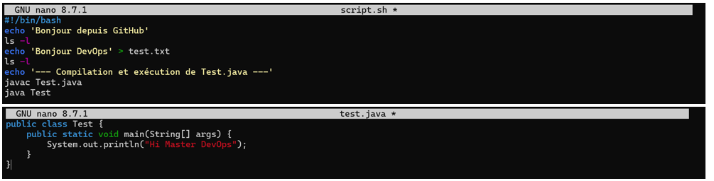

**Capture 20 — Publication sur GitHub**

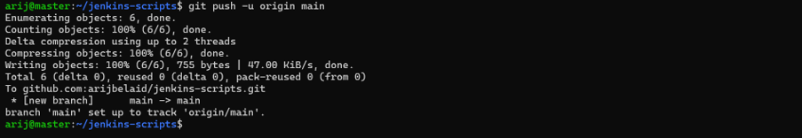

## 12. Déclenchement automatique

Le job peut être configuré pour s’exécuter périodiquement.

### 12.1 Planification

Dans la section **Déclencheurs de build**, cocher **Construire périodiquement** et utiliser :

```text
H/5 * * * *
```

Cette expression planifie une exécution environ toutes les cinq minutes, selon la répartition déterminée par Jenkins.

### 12.2 Conservation des builds

Dans la section de conservation des anciens builds, activer la rotation des journaux et définir une limite de deux builds.

### 12.3 Nettoyage du workspace

Activer l’option **Delete workspace before build starts** si le plugin correspondant est installé et si cette option est disponible.

**Capture 21 — Configuration du déclenchement périodique**

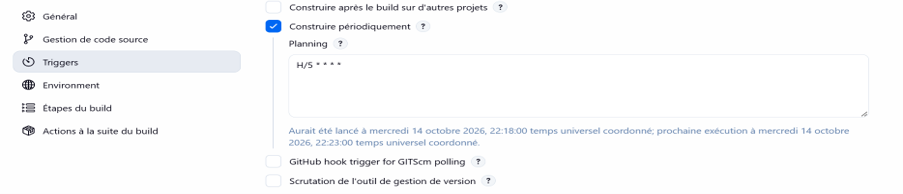

## 13. Configuration de Jenkins pour Docker et Kubernetes

Pour exécuter le pipeline complet, l’utilisateur système Jenkins doit pouvoir utiliser Docker et accéder au cluster Kubernetes.

### 13.1 Accès à Docker

```bash
sudo usermod -aG docker jenkins
sudo systemctl restart jenkins
```

Tester l’accès :

```bash
sudo -u jenkins docker ps
```

> L’accès au groupe `docker` confère des privilèges élevés sur la machine. Il doit être accordé uniquement dans un environnement de TP maîtrisé.

**Capture 22 — Ajout de Jenkins au groupe Docker**

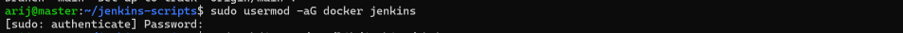

### 13.2 Configuration du kubeconfig

Copier la configuration Kubernetes de l’utilisateur administrateur vers le compte Jenkins :

```bash
sudo mkdir -p /var/lib/jenkins/.kube

sudo cp /home/arij/.kube/config \
  /var/lib/jenkins/.kube/config

sudo chown -R jenkins:jenkins /var/lib/jenkins/.kube
sudo chmod 600 /var/lib/jenkins/.kube/config
```

Vérifier que le fichier kubeconfig utilise une adresse API accessible depuis Jenkins. Protéger ce fichier et ne pas publier ses certificats ou identifiants dans GitHub.

**Capture 23 — Configuration du kubeconfig**

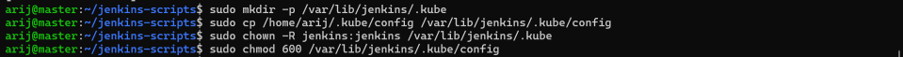

### 13.3 Vérification des accès

```bash
sudo -u jenkins kubectl get nodes
sudo -u jenkins kubectl get pods --all-namespaces
```

Les trois nœuds doivent être en état `Ready`.

**Capture 24 — Vérification des permissions**

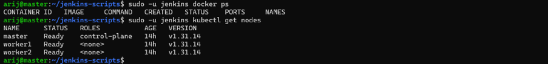

## 14. Pipeline automatisé complet

Le job `deploy_spring_k8s` automatise les différentes opérations du pipeline.

### 14.1 Étapes du pipeline

1. Récupération du code source depuis GitHub.
2. Compilation Maven.
3. Vérification du Dockerfile.
4. Construction de l’image Docker.
5. Authentification auprès de Docker Hub.
6. Publication de l’image.
7. Application des manifests Kubernetes.
8. Redémarrage du déploiement.
9. Vérification des pods et du service.

### 14.2 Script de déploiement

Dans le job Freestyle, après avoir configuré le dépôt Git et les identifiants nécessaires, ajouter une étape d’exécution shell :

```bash
#!/bin/bash
set -e

IMAGE="arijbelaid/jenkins-demo:latest"
DEPLOYMENT="spring-app-deployment"

echo "=== 1. BUILD MAVEN ==="
mvn clean install -DskipTests

echo "=== 2. VERIFICATION DU DOCKERFILE ==="
cat Dockerfile

echo "=== 3. BUILD DOCKER ==="
docker build -t "$IMAGE" .

echo "=== 4. LOGIN DOCKER HUB ==="
echo "$DOCKER_PASS" | docker login \
  -u arijbelaid \
  --password-stdin

echo "=== 5. PUSH DOCKER HUB ==="
docker push "$IMAGE"

echo "=== 6. DEPLOIEMENT KUBERNETES ==="
kubectl apply -f deployment.yaml
kubectl apply -f service.yaml

echo "=== 7. REDEMARRAGE DU DEPLOIEMENT ==="
kubectl rollout restart "deployment/$DEPLOYMENT"

echo "=== 8. ATTENTE DU ROLLOUT ==="
kubectl rollout status "deployment/$DEPLOYMENT" \
  --timeout=180s

echo "=== 9. VERIFICATION DES PODS ==="
kubectl get pods -o wide

echo "=== 10. VERIFICATION DU SERVICE ==="
kubectl get svc
```

### Configuration importante

- Configurer `DOCKER_PASS` dans Jenkins comme identifiant secret ou variable d’environnement protégée. Ne pas inscrire le mot de passe directement dans le script ou le dépôt.
- Installer Maven, Docker et `kubectl` sur l’agent Jenkins qui exécute le job.
- Vérifier que le `Dockerfile` se trouve dans le workspace du job.
- Vérifier que `deployment.yaml` et `service.yaml` utilisent la bonne image et le bon port.
- Préférer des tags d’image uniques plutôt que `latest` pour faciliter le suivi des versions.
- Utiliser un Dockerfile valide et versionné dans GitHub.

### 14.3 Captures du pipeline

**Capture 25 — Exécution du build Jenkins**

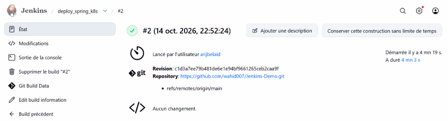

**Capture 26 — Console du déploiement**

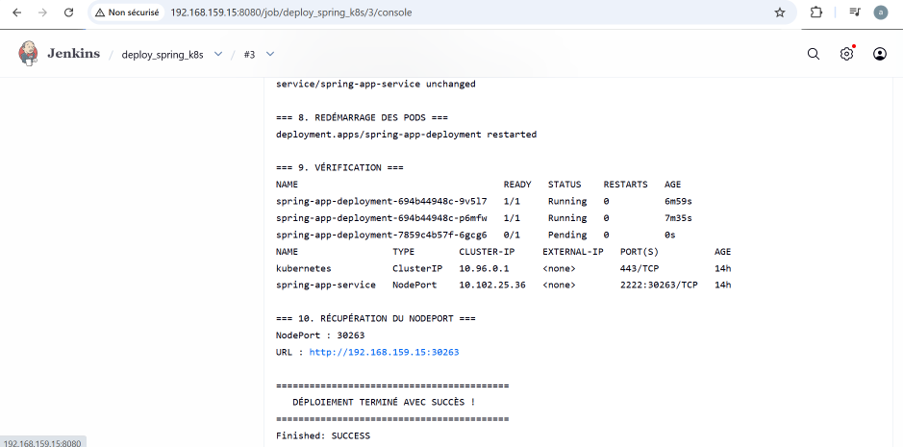

## 15. Vérification finale

### 15.1 Vérification des pods

```bash
kubectl get pods -o wide
```

Les pods de l’application doivent être en état `Running` et afficher un statut de disponibilité correct.

**Capture 27 — Pods Kubernetes en Running**

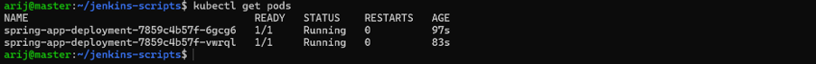

### 15.2 Vérification du déploiement

```bash
kubectl rollout status deployment/spring-app-deployment
kubectl get deployment spring-app-deployment
```

### 15.3 Vérification du service

```bash
kubectl get svc spring-app-service
```

Le service doit être de type `NodePort` si l’application est exposée de cette manière.

### 15.4 Accès à l’application

Dans l’environnement documenté, l’URL d’accès est :

```text
http://192.168.159.15:30263
```

Le port `30263` est celui relevé pendant le TP. Vérifier le port NodePort réel avec `kubectl get svc` avant d’utiliser cette URL.

Message attendu dans l’application :

```text
Welcome to Jenkins Tutorial for Master DevOps and Cloud!

Welcome to Jenkins CI/CD Pipeline for Spring Boot Microservice application deployed to Kubernetes using Helm
```

**Capture 28 — Test final de l’application**

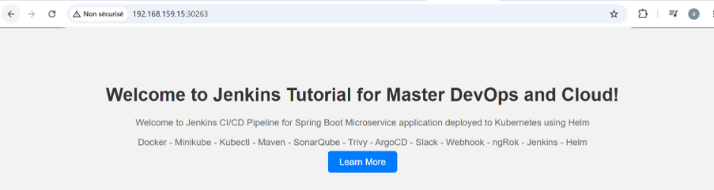

## 16. Structure du dépôt

```text
jenkins-scripts/
├── README.md
├── script.sh
├── Test.java
├── rapport.pdf
└── captures/
    ├── 01-clone-repo.png
    ├── 02-dockerfile.png
    ├── 03-mvn-build-success.png
    ├── 04-docker-build.png
    ├── 05-docker-login.png
    ├── 06-docker-tag.png
    ├── 07-docker-push.png
    ├── 08-docker-run.png
    ├── 09-curl-test.png
    ├── 10-k8s-deployment.png
    ├── 11-freestyle-config.png
    ├── 12-freestyle-dashboard.png
    ├── 13-freestyle-build-console.png
    ├── 14-freestyle-verify-vm.png
    ├── 15-testjava-nano.png
    ├── 16-testjava-chown.png
    ├── 17-testjava-job-config.png
    ├── 18-testjava-console.png
    ├── 19-github-script.png
    ├── 20-github-push.png
    ├── 21-trigger-config.png
    ├── 22-jenkins-docker-group.png
    ├── 23-kubeconfig-copy.png
    ├── 24-jenkins-permissions.png
    ├── 25-deploy-k8s-build.png
    ├── 26-deploy-k8s-console.png
    ├── 27-k8s-pods-running.png
    └── 28-application-test.png
```

## 17. Auteur et liens utiles

**Auteur :** Arij Belaid

**Formation :** Master Professionnel DevOps & Cloud

### Ressources du projet

- **Dépôt GitHub :** [arijbelaid/jenkins-scripts](https://github.com/arijbelaid/jenkins-scripts)
- **Projet Spring Boot :** [Wahid007/Jenkins-Demo](https://github.com/wahid007/Jenkins-Demo)
- **Docker Hub :** [hub.docker.com/u/arijbelaid](https://hub.docker.com/u/arijbelaid)
- **Documentation Jenkins :** [jenkins.io/doc](https://www.jenkins.io/doc/)
- **Documentation Docker :** [docs.docker.com](https://docs.docker.com/)
- **Documentation Kubernetes :** [kubernetes.io/docs](https://kubernetes.io/docs/)
- **Documentation Maven :** [maven.apache.org](https://maven.apache.org/)

---

## 🏆 Conclusion

Ce TP a permis de mettre en pratique les principales étapes d’un processus CI/CD : compilation d’une application Java avec Maven, création et publication d’une image Docker, configuration de Jenkins et déploiement sur un cluster Kubernetes.

La combinaison de ces outils constitue une base pour comprendre l’automatisation des livraisons logicielles et les pratiques DevOps.

*Projet réalisé dans un cadre pédagogique — Master Professionnel DevOps & Cloud.*
